  

# Awesome Wealth Management    

> A curated directory of premier **Wealth Management Software**, **FinTech SaaS Platforms**, and **Open-Source GitHub Projects** for portfolio tracking, net-worth dashboards, automated robo-advisory, investment analytics, and Registered Investment Advisor (RIA) technology stacks.

**Last updated: October 2026**

---

## Table of Contents

- [Overview](#overview)
- [Sector Overview & Market Dynamics](#sector-overview--market-dynamics)
- [SaaS & Hosted Wealth Management Platforms](#saas--hosted-wealth-management-platforms)
- [Open-Source GitHub Projects](#open-source-github-projects)
- [Architecture & Selection Matrix](#architecture--selection-matrix)
- [Frequently Asked Questions (FAQ)](#frequently-asked-questions-faq)
- [How to Contribute](#how-to-contribute)
- [Disclaimer](#disclaimer)

---

## Overview

Modern wealth management bridges enterprise financial infrastructure with personal portfolio intelligence. This repository serves as a comprehensive reference guide to:
- **Enterprise & Advisor SaaS Platforms**: Turnkey Asset Management Platforms (TAMPs), portfolio accounting systems, and reporting engines built for RIAs, family offices, and wealth managers.
- **Consumer FinTech & Robo-Advisors**: Digital wealth dashboards, automated tax-loss harvesting, and multi-asset account aggregators.
- **Open-Source & Local-First Tools**: Self-hosted wealth management applications, privacy-first portfolio trackers, quantitative research platforms, and plain-text accounting tools.

---

## Sector Overview & Market Dynamics

- **Estimated Market Size**: The global wealth management software market is estimated at **$6.4B to $8.1B in 2025** and projected to reach **$7.3B to $8.5B+ in 2026**, growing at a compound annual growth rate (CAGR) of **12.5% to 15.2%**.
- **Market Concentration & Dynamics**: The industry operates under a **moderately fragmented, two-tier market structure** rather than a winner-take-all environment. While the tier-1 institutional core is concentrated among legacy titans (such as SS&C Technologies, Envestnet, Broadridge, and Avaloq commanding ~68% cumulative market share across large enterprise banks and wirehouses), the broader market for independent RIAs, multi-family offices, and retail investors remains deeply fragmented. This ongoing fragmentation is propelled by disparate international regulatory regimes (SEC/FINRA in the US vs. MiFID II / ESG frameworks in the EU), custodian data incompatibilities, and high demand for specialized agile tools (automated tax-loss harvesting, alternative asset accounting, and robo-advisory engines).

---

## SaaS & Hosted Wealth Management Platforms

The table below lists top commercial SaaS wealth platforms, sorted in descending order by **Company Size (Valuation / Revenue / Assets)**:

| Platform | Category / Focus | Company Size (Valuation / Revenue) | Starting Pricing | Free Tier Limit |
| :--- | :--- | :--- | :--- | :--- |
| **[Morningstar](https://www.morningstar.com/)** | Investment Research & Wealth Analytics | **$14.2B** Market Cap (NASDAQ: MORN) / $2.1B Rev | $34.95/month (or $249/year) for Morningstar Investor; $2,900/year/seat for Advisor Workstation | 7-day full-access free trial of Morningstar Investor; free registered account with delayed watchlist data |
| **[Envestnet](https://www.envestnet.com/)** | Turnkey Asset Management & RIA Portfolio Accounting | **$4.5B** Valuation (Bain Capital) / $1.3B Rev | $65/month base fee + $45/account/year (or ~0.02% AUM) for core RIA platform | 30-day interactive sandbox trial with sample institutional portfolios for licensed advisors |
| **[Orion Advisor Solutions](https://orion.com/)** | Advisor Operations, Trading & Portfolio Accounting | **$2.5B** Valuation (Genstar / TA) / $300M+ Rev | $1,000/month ($12,000/year base) + $55 to $105/account/year | 30-day guided pilot sandbox trial with preloaded model portfolios for advisory firms |
| **[Addepar](https://addepar.com/)** | Multi-Asset Portfolio Accounting & Family Office Analytics | **$2.17B** Valuation (Series F) / $150M+ Rev | $25,000/year base platform fee (covers up to $100M AUM; approx 1–3 bps scaling thereafter) | 14-day guided proof-of-concept sandbox demo trial with custom portfolio data import |
| **[Wealthfront](https://www.wealthfront.com/)** | Automated Wealth Management & Robo-Advisory | **$1.4B** Valuation / $70B+ Assets | 0.25% AUM/year advisory fee ($500 minimum opening deposit) | Free forever high-yield cash account ($0 management fee) and lifetime financial planning pathfinder |
| **[Betterment](https://www.betterment.com/)** | Automated Investing & Goal-Based Portfolio Management | **$1.3B** Valuation (Series F) / $45B+ AUM | $4.00/month flat fee (or 0.25% AUM/year with $250+/mo deposits or $20k+ balance) | 30-day fee-waived free trial on automated investing portfolios; free forever cash reserve accounts |
| **[Empower (Personal Capital)](https://www.empower.com/)** | Digital Wealth Management & Net Worth Tracking | **$1.0B** Valuation (Empower) / $1.5T+ AUA | 0.89% AUM/year for first $1M ($100k minimum portfolio) for advisory services | Free forever financial dashboard with unlimited account aggregation, net worth tracking, and retirement planner |
| **[Quicken](https://www.quicken.com/)** | Personal Finance, Budgeting & Investment Tracking | **$1.0B** Valuation (Aquiline) / $150M+ Rev | $2.99/month ($35.88/year billed annually) for Simplifi; $5.99/month ($71.88/year) for Classic Premier | 30-day full-access free trial on Quicken Simplifi; 30-day money-back satisfaction guarantee on desktop |
| **[Sharesight](https://www.sharesight.com/)** | Investment Performance & Tax Reporting Platform | **$50M** Valuation / $50B+ Tracked Assets | $15.00/month ($180/year billed annually) for Starter plan (up to 30 holdings, 3 portfolios) | Free forever plan supporting 1 investment portfolio and up to 10 stock/crypto holdings |
| **[Kubera](https://www.kubera.com/)** | Global Multi-Currency Net Worth & Asset Tracker | **$35M** Valuation / $25B+ Tracked Assets | $150.00/year ($12.50/month equivalent) for Personal plan | 14-day trial for $1 with unlimited multi-currency assets, crypto DeFi wallets, and global bank sync |
| **[Vyzer](https://vyzer.co/)** | Alternative Assets & Private Equity Wealth Dashboard | **$20M** Valuation / $5B+ Tracked Assets | $29.00/month ($348/year billed annually) for Starter tier (up to 15 assets, auto-sync) | Free forever plan supporting up to 3 manual asset accounts, 1 financial institution sync, and manual tracking |

---

## Open-Source GitHub Projects

The following open-source projects are sorted in descending order by **GitHub Stars**, featuring direct links to each project's stargazers community:

- **[OpenBB](https://github.com/openbb-finance/OpenBB)**   
  Open-source investment research and financial data platform for quants, wealth managers, and analysts—a modular open alternative to the Bloomberg Terminal.

- **[Maybe Finance](https://github.com/maybe-finance/maybe)**   
  Modern personal finance and wealth management application built to track net worth, investment accounts, and financial independence trajectories.

- **[Actual Budget](https://github.com/actualbudget/actual)**   
  Local-first, privacy-focused personal finance and net-worth tracking system featuring multi-device synchronization and optional bank integration.

- **[Firefly III](https://github.com/firefly-iii/firefly-iii)**   
  Self-hosted financial manager providing double-entry budgeting, cash-flow categorization, asset accounts, and liability tracking.

- **[Ghostfolio](https://github.com/ghostfolio/ghostfolio)**   
  Open-source wealth management web application (Angular + NestJS + Prisma) to track stocks, ETFs, and crypto with risk metrics (Sharpe ratio, max drawdown) and data ownership.

- **[Wealthfolio](https://github.com/wealthfolio/wealthfolio)**   
  Private, local-first investment tracker and net-worth management desktop application supporting multiple asset classes, dividend tracking, and portfolio simulations.

- **[Beancount](https://github.com/beancount/beancount)**   
  Double-entry plain-text accounting tool designed for precision tracking of investments, capital gains, balance sheets, and custom wealth dashboards (via Fava).

- **[Ledger](https://github.com/ledger/ledger)**   
  Powerful command-line double-entry accounting software used to audit and model personal investment portfolios, securities lots, and multi-currency assets.

- **[hledger](https://github.com/hledgerorg/hledger)**   
  Robust, fast plain-text accounting suite with CLI, terminal UI, and web interfaces for tracking income, expenses, and portfolio valuation over time.

- **[Cointop](https://github.com/cointop-sh/cointop)**   
  Lightweight interactive terminal UI application for tracking cryptocurrency investments, holdings value, and digital asset portfolio performance.

- **[Portfolio Performance](https://github.com/portfolio-performance/portfolio)**   
  Comprehensive open-source desktop software to calculate portfolio performance (True Time-Weighted Rate of Return, IRR) across stocks, bonds, cryptos, and ETFs.

- **[Rotki](https://github.com/rotki/rotki)**   
  Privacy-centric portfolio tracking, accounting, analytics, and tax reporting application supporting traditional finance, DeFi, and crypto assets.

- **[Aurelio Finance](https://github.com/LosaLosSantos/aurelio-finance)**   
  Open-source personal finance app featuring an AI financial advisor to analyze investments, cash flows, net worth, and long-term financial plans locally.

- **[Paisa](https://github.com/ananthakumaran/paisa)**   
  Modern personal finance and wealth dashboard tailored for plain-text ledger files, providing interactive charts, net-worth trajectories, and investment analytics.

- **[Money Manager Ex](https://github.com/moneymanagerex/moneymanagerex)**   
  Cross-platform, open-source personal wealth and money management software offering stock and mutual fund tracking, cash flow forecasting, and budgeting.

- **[Sossoldi](https://github.com/RIP-Comm/sossoldi)**   
  Clean Flutter-based open-source wealth management, personal finance, and net-worth tracking mobile application.

- **[InvestBrain](https://github.com/investbrainapp/investbrain)**   
  AI-powered investment tracking application that consolidates portfolios across multiple brokerages with automated performance and allocation monitoring.

---

## Architecture & Selection Matrix

| Solution Tier | Primary Archetype | Data Hosting | Best Suited For | Key Advantages |
| :--- | :--- | :--- | :--- | :--- |
| **Enterprise RIA Platforms** | Addepar, Envestnet, Orion | Cloud Multi-Tenant / VPC | RIAs, Family Offices, Institutions | Institutional custodian feeds, complex billing, regulatory compliance |
| **Robo-Advisors & Consumer SaaS** | Wealthfront, Empower, Betterment | Hosted Cloud SaaS | Individual Investors, HNWIs | Zero-effort bank syncing, automated rebalancing, tax-loss harvesting |
| **Self-Hosted Web Applications** | Ghostfolio, Maybe Finance | Self-Hosted Docker / VPS | Self-Hosters, Tech-Savvy Investors | Full data sovereignty, custom API feeds, modern web UIs |
| **Local-First Desktop Software** | Wealthfolio, Portfolio Performance | Local Disk (No Cloud) | Privacy Enthusiasts, Global Traders | Absolute data privacy, offline performance metrics (TTWROR/IRR) |
| **Plain-Text Accounting (PTA)** | Beancount, Ledger, hledger | Plain-Text Git Repos | Developers, Quants, Engineers | Git version control, precision double-entry auditing, scriptable reporting |

---

## Frequently Asked Questions (FAQ)

### What is the best open-source alternative to commercial portfolio trackers?
**[Ghostfolio](https://github.com/ghostfolio/ghostfolio)** and **[Wealthfolio](https://github.com/wealthfolio/wealthfolio)** are the premier open-source alternatives to commercial trackers like Kubera or Sharesight. Ghostfolio offers an easy Docker-compose deployment with modern web aesthetics, while Wealthfolio provides a local-first desktop application with offline data security.

### How do open-source portfolio trackers handle live market prices?
Most open-source solutions integrate with public or free-tier financial APIs such as Yahoo Finance, Alpha Vantage, Finnhub, or CoinGecko. Plain-text tools like Beancount and Ledger utilize tools like `bean-price` or custom Python scraping scripts to fetch daily valuations.

### Which tools support multi-asset classes, including crypto and private investments?
For commercial SaaS, **Addepar** and **Vyzer** excel at handling complex private equity, real estate, and venture capital syndications. In open-source software, **Rotki** and **Portfolio Performance** excel at managing mixed portfolios of global equities, fixed income, foreign currencies, and decentralized crypto assets.

### What is the difference between personal wealth tools and RIA advisor platforms?
Personal wealth tools (e.g., Empower, Quicken, Ghostfolio) focus on personal balance sheets, budgeting, and net worth trajectory. In contrast, institutional platforms (e.g., Envestnet, Orion, Addepar) incorporate fiduciary compliance auditing, multi-custodian reconciliation (Schwab, Fidelity, BNY Mellon), client billing schedules, and household performance reporting.

---

## How to Contribute

1. Fork this repository.
2. Add or refine entries in `README.md` following the standardized table or listing format.
3. Ensure all links point to authoritative sources and descriptions remain neutral and objective.
4. Open a Pull Request with a succinct title and description.

Contributions and community suggestions are always welcome! ⭐ Star this repository to support future developments.

---

## Disclaimer

- This curated list is maintained for educational and informational purposes only and does not constitute financial, investment, or legal advice.
- Financial software and market data feeds can misprice complex assets or fail to capture certain corporate actions; always reconcile with primary custodian statements.
- Self-hosted applications require users to manage their own database backups, secret keys, and network security.

---

**SEO Keywords**: `wealth-management-software`, `portfolio-tracker`, `open-source-finance`, `net-worth-dashboard`, `fintech`, `personal-capital-alternative`, `robo-advisor`, `ria-tech-stack`, `family-office-software`, `beancount`, `ghostfolio`, `openbb`, `wealthtech`
